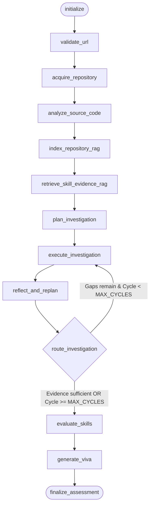

# SkillProof AI — LangGraph Orchestration & Workflow

## 1. Overview & Graph Architecture

SkillProof AI utilizes LangGraph (`langgraph`, `langchain-core`) as its primary agent orchestration engine. It replaces linear or static script sequences with a stateful directed graph featuring conditional cyclic investigation and persistent SQLite checkpointing.



---

## 2. State Representation (`AssessmentState`)

The graph state is defined as a typed dictionary (`AssessmentState` in `backend/agents/graph.py`):

```python
class AssessmentState(TypedDict):
    session_id: str
    candidate_id: str
    github_url: str
    requested_sha: Optional[str]
    claimed_skills: List[str]
    current_status: str
    workspace_path: Optional[str]
    repository_commit_sha: Optional[str]
    repository_snapshot: Dict[str, Any]
    inventory: List[str]
    code_evidence: List[Dict[str, Any]]
    evidence_graph: List[Dict[str, Any]]
    rag_indexed: bool
    rag_chunks_count: int
    rag_evidence: Dict[str, Any]
    baseline: Optional[Dict[str, Any]]
    commit_summary: Optional[Dict[str, Any]]
    similarity_findings: Optional[Dict[str, Any]]
    test_results: Optional[Dict[str, Any]]
    analysis_plan: Optional[Dict[str, Any]]
    missing_evidence: List[str]
    agent_cycles: List[Dict[str, Any]]
    investigation_cycles: int
    stop_reason: Optional[str]
    assessments: List[Dict[str, Any]]
    skill_scores: Dict[str, Any]
    viva_questions: List[Dict[str, Any]]
    viva_responses: List[Dict[str, Any]]
    llm_calls: int
    error: Optional[str]
```

---

## 3. Node Specifications

| Node Name | Input State Fields | Output State Fields | Functional Responsibility |
|---|---|---|---|
| `initialize` | `session_id`, `github_url` | `current_status: "INITIALIZING"` | Initializes session timestamps, deadlines, and cycle tracking. |
| `validate_url` | `github_url` | `current_status: "PLANNING"` | Enforces security checks: public GitHub hostname, no SSRF, no credentials. |
| `acquire_repository` | `github_url`, `requested_sha` | `workspace_path`, `repository_commit_sha`, `repository_snapshot`, `inventory` | Performs shallow clone, discovers commit SHA, computes file hashes. |
| `analyze_source_code` | `workspace_path`, `inventory` | `code_evidence`, `evidence_graph`, `commit_summary`, `test_results`, `baseline` | Executes deterministic AST parsing, git forensics, and static test discovery. Freezes reproducible baseline. |
| `index_repository_rag` | `inventory`, `repository_commit_sha` | `rag_indexed`, `rag_chunks_count` | Chunks code via AST/line-blocks and stores embeddings in SQLite `rag_chunks`. |
| `retrieve_skill_evidence_rag` | `claimed_skills`, `repository_commit_sha` | `rag_evidence` | Queries vector store for semantic matches per skill and converts to traceable items. |
| `plan_investigation` | `code_evidence`, `rag_evidence`, `claimed_skills` | `analysis_plan`, `missing_evidence`, `current_status: "ANALYSING"` | LLM planner reasons over evidence gaps and selects dynamic tool actions. |
| `execute_investigation` | `analysis_plan`, `workspace_path` | `code_evidence`, `evidence_graph`, `agent_cycles` | Safely executes tool actions (`inspect_files`, `find_tests`, etc.) within budget. |
| `reflect_and_replan` | `code_evidence`, `agent_cycles` | `missing_evidence`, `investigation_cycles` | Evaluates new evidence, updates remaining gaps, increments cycle counter. |
| `evaluate_skills` | `code_evidence`, `claimed_skills` | `assessments`, `skill_scores`, `current_status: "EVALUATING"` | Scores candidate skills strictly supported by verifiable citations. |
| `generate_viva` | `code_evidence`, `assessments` | `viva_questions`, `current_status: "VIVA_PENDING"` | Employs Gemini to draft 5 source-grounded viva questions referencing exact symbols. |
| `finalize_assessment` | All state | `current_status: "VIVA_PENDING"` | Verifies state completeness, records final audit log, and yields control to viva. |

---

## 4. Dynamic Investigation Routing (`route_investigation`)

The investigation cycle is not a fixed script. It uses conditional routing based on dynamic observations:

```python
def route_investigation(state: AssessmentState) -> str:
    cycles = state.get("investigation_cycles", 0)
    missing = state.get("missing_evidence", [])
    stop_reason = state.get("stop_reason")

    if cycles >= config.MAX_CYCLES:  # Default MAX_CYCLES = 3
        return "evaluate_skills"
    if stop_reason in {"EVIDENCE_SUFFICIENT", "NO_USEFUL_ACTIONS"}:
        return "evaluate_skills"
    if not missing and cycles > 0:
        return "evaluate_skills"
    return "execute_investigation"
```

### Stop Reasons
- `EVIDENCE_SUFFICIENT`: All claimed skills have verified supporting evidence citations.
- `NO_USEFUL_ACTIONS`: Planner determines no further safe inspection actions can discover new evidence.
- `INVESTIGATION_BUDGET_EXHAUSTED`: Hit `MAX_CYCLES = 3`.
- `TIME_BUDGET_EXCEEDED`: Exceeded the session deadline (`AGENT_BUDGET_SECONDS = 300`).

---

## 5. State Persistence & Checkpointing

### SqliteSaver Checkpointer
LangGraph graph state is persisted using `SqliteSaver.from_conn_string("sqlite:///db.sqlite3")`.
- **Thread Isolation**: The `thread_id` corresponds directly to `session_id`.
- **Fault-Tolerant Resumption**: In case of server interruption, `orchestrator.recover()` inspects unfinished sessions, restores the checkpoint from SQLite, and resumes execution without re-cloning or mutating the frozen baseline commit SHA.
